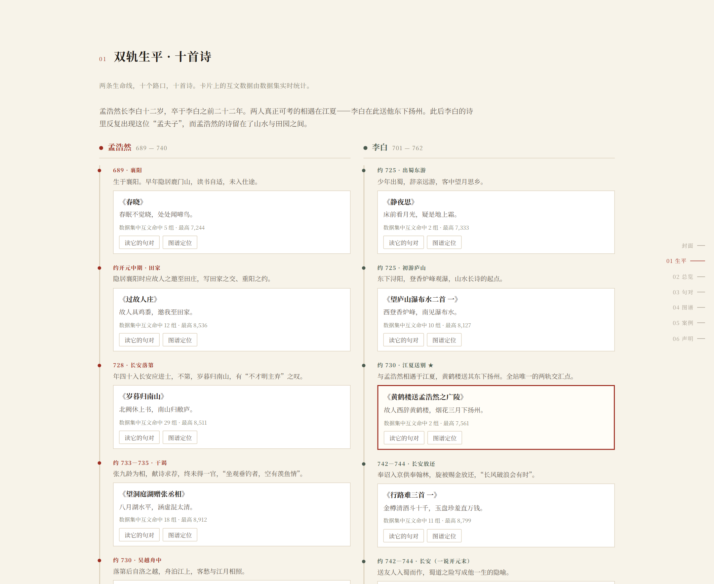
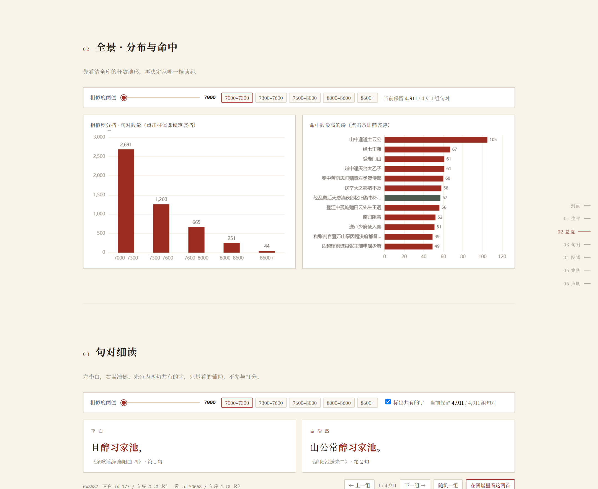
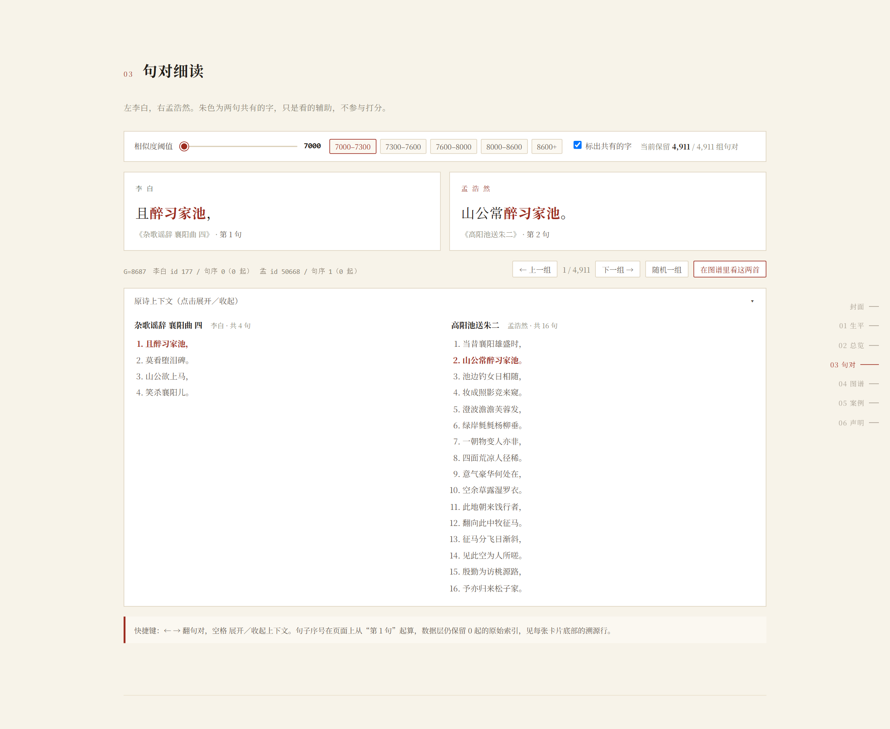

# 当李白遇到孟浩然 · 诗歌互文网络可视化

一个关于「网络互文」的单页数字人文站点：把李白与孟浩然之间的 **4,911 组句级相似对照**，从一张表变成可读、可筛、可追溯的网络。

- 纯静态：`index.html` + `data.js` + 一张封面图，无框架、无构建、无后端
- 数据全部来自三份原始 CSV，未编造任何诗句、诗号、句序与相似度
- 可直接部署 GitHub Pages，也可本地双击打开


## 目录结构

```
.
├── index.html               # 站点主文件（全部交互在此）
├── data/
│   ├── 李白.csv              # 原始数据（只读，不参与构建改动）
│   ├── 孟浩然.csv
│   ├── 李白-孟浩然.csv
│   ├── data.js              # 由脚本生成，页面直接读取：window.SITE_DATA
│   └── data.json            # 同一份数据的 JSON 版本，便于外部核对
├── assets/
│   ├── cover.jpg            # 首页封面
│   └── echarts.min.js       # 本地 ECharts 5.5.1，离线也能跑
├── tools/
│   └── build_data.py        # CSV → data.js / data.json
├── shots/                   # 站点截图（README 用）
└── README.md
```

## 章节与交互

| 章节 | 内容 | 交互 |
|---|---|---|
| 封面 | 水墨人物与标题 | 滚动进入 |
| 01 双轨生平 | 孟浩然 689–740 ／ 李白 701–762，两条时间线共十个节点，每个节点配一首诗 | 每张诗卡显示该诗在数据集中的真实命中组数与最高分；“读它的句对”“图谱定位”直达对应视图 |
| 02 全景 | 相似度分档柱状图、命中数排行 | 点柱体锁定该档；点条形筛出该诗的全部句对 |
| 03 句对细读 | 左李白、右孟浩然，共有字以朱色标出 | 阈值滑块、快捷分档、上一组／下一组／随机、高亮开关、原诗上下文折叠、键盘 ← → 与空格 |
| 04 图谱 | 诗—诗力导向网络，边宽映射最高相似度 | 点节点看该诗全部匹配、点连线看两首诗之间的全部句对、诗题搜索、核心／中等／全部三种范围（「显示范围」的入选规则写在页内） |
| 05 案例 | 按原始分值取前六组 | 一键跳到句对读或图谱 |
| 06 声明 | 数据来源、口径、异文与边界 | — |

三个滑块共用同一份状态：任意一处改阈值，柱状图、句对读、图谱与计数同时刷新。


## 数据口径

三份 CSV 均无表头，逐行为一条记录：

| 文件 | 列 |
|---|---|
| `李白.csv` | 诗题 · 诗句 · 诗歌 id · 诗句序号（0 起） |
| `孟浩然.csv` | 同上 |
| `李白-孟浩然.csv` | 李白 · 李诗题 · 李诗句 · 孟浩然 · 孟诗题 · 孟诗句 · **G 相似度** · **H 李诗 id** · **I 李句 id（0 起）** · **J 孟诗 id** · **K 孟句 id（0 起）** |

- **G 为 10000 制相似度**，实测区间 7000–10000，中位数 7260；网站阈值范围固定 7000–10000，原始文件完整保留全部记录。
- 筛选、排序与图谱边权一律使用 G 原始值；页面上标出的「共有字」只是阅读辅助，不参与任何计算。
- **I / K 在数据层保持 0 起**，页面展示时统一 +1 显示为“第 n 句”，卡片底部同时给出原始索引，可逐条回查。
- 诗句文本一律照 CSV 原文，不改回通行本。例如《静夜思》在数据集中作“床前看月光”“举头望山月”，《黄鹤楼送孟浩然之广陵》作“碧山尽”——页面保留这些异文。

当前统计（由脚本生成，可在 `data/data.json` 的 `meta` 中核对）：

| 项 | 数值 |
|---|---|
| 李白 | 1,084 首 / 14,469 句 |
| 孟浩然 | 269 首 / 2,553 句 |
| 互文句对 | 4,911 组 |
| 涉及诗作（节点） | 1,190 首 |
| 诗对连线（全部） | 4,713 条 |

分档分布：7000–7300 有 2,691 组，7300–7600 有 1,260 组，7600–8000 有 665 组，8000–8600 有 251 组，8600 以上 44 组。

## 本地运行

方式一：直接双击 `index.html`。数据以 `data.js` 注入，`file://` 下也能正常显示。

方式二：起一个静态服务（推荐，行为与线上一致）：

```bash
python -m http.server 8000
# 打开 http://localhost:8000
```

## 重新生成数据

修改或替换 `data/` 下的 CSV 后执行：

```bash
python tools/build_data.py
```

脚本只读原始 CSV，不改写任何单元格；诗句按 `(诗歌 id, 句序号)` 回查原文，缺失则跳过并计入 `meta.skipped_rows`，不会用别的内容补齐。

## 部署到 GitHub Pages

```bash
git init
git add .
git commit -m "李白×孟浩然 诗歌互文网络可视化"
git branch -M main
git remote add origin https://github.com/<你的用户名>/<仓库名>.git
git push -u origin main
```

然后在仓库 **Settings → Pages** 中，把 Source 设为 `Deploy from a branch`，Branch 选 `main`、目录选 `/ (root)`，保存后等待一分钟，访问 `https://<用户名>.github.io/<仓库名>/`。

站点全部使用相对路径，无需改动即可在子路径下运行。

## 说明与边界

- 相似度是字面层面的机器打分，**不等于**化用、酬唱、借鉴等文学判断；它只能说明“这两句长得像”。
- 本章生平事件为通行文史叙述，系年有异说者标“约”；诗题、诗句、命中数与分值全部来自数据集。
- 案例按分值前六动态生成，不人工挑选，也不为叙事增删。
- 图谱的「显示范围」是画布上的可读性筛选（每首诗命中组数 ≥ N），不是数据字段；规则同样写在网页 04 章内。

## 致谢

本页的选题、方法与数据，承上海交通大学数字人文段思宇老师指导并提供，谨致谢忱。

## 截图

| | |
|---|---|
|  |  |
|  |  |
